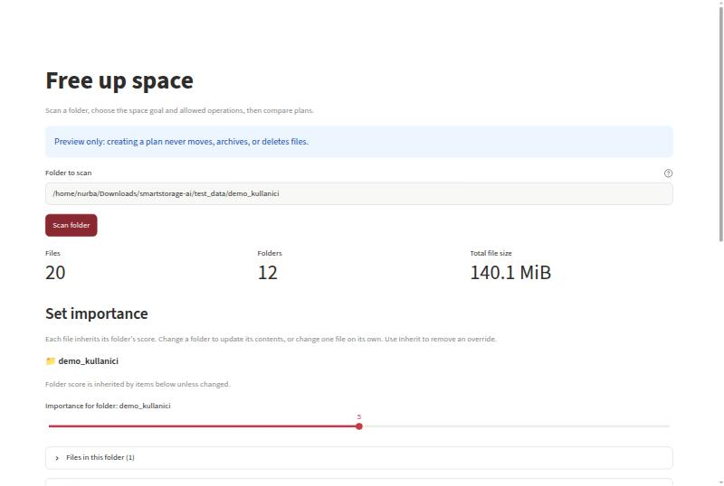
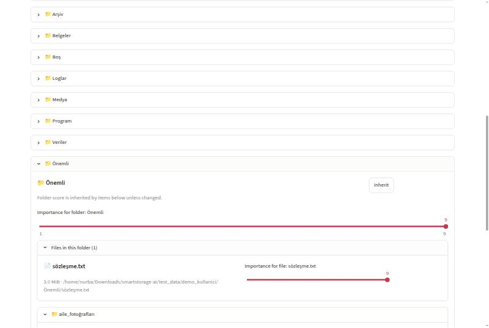
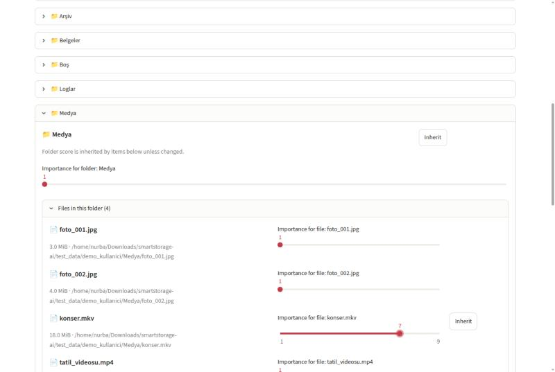
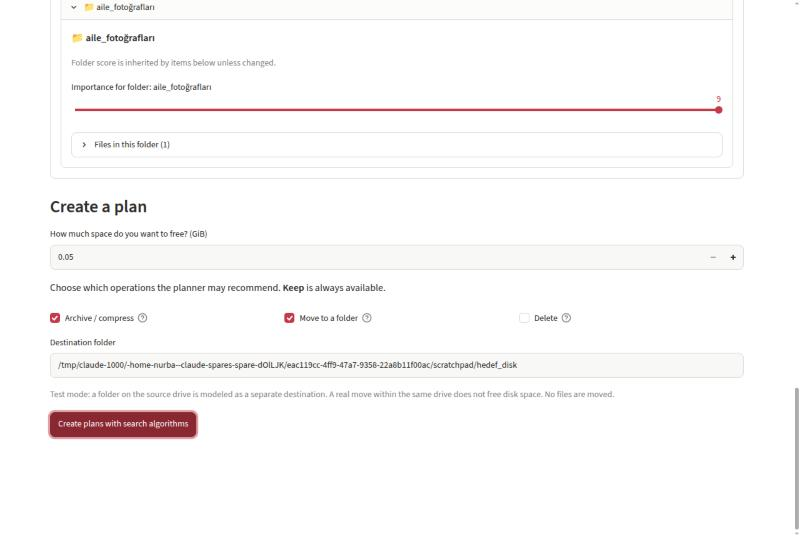
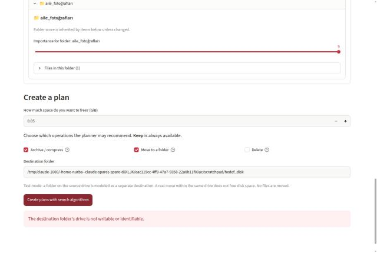
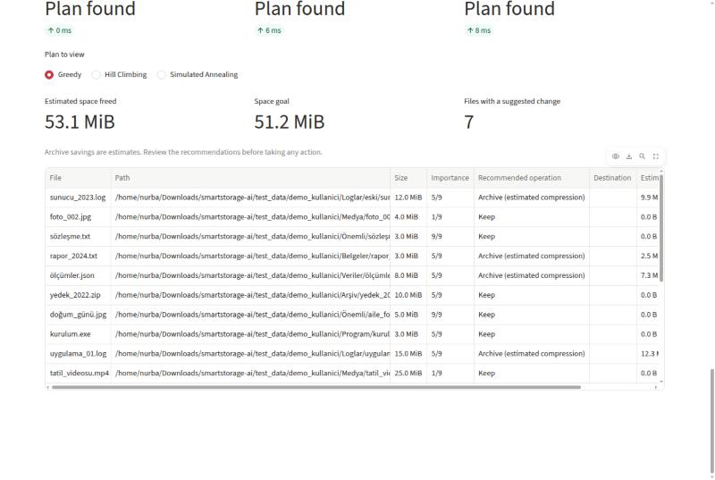

# SmartStorage AI — Ara Rapor: Kullanıcı Arayüzü (UI) Aşaması

**Ders:** Yapay Zekâ – Dönem Projesi
**Tarih:** 11.11.2026
**Kapsam:** Bu rapor, arama algoritmalarına geçmeden önce tamamlanan kısmı anlatır: klasör seçimi ve tarama, dosya/klasör önem puanlama, plan oluşturma ayarları ve güvenlik kuralları.

> **Önemli:** Uygulama yalnızca öneri (önizleme) modunda çalışır. Hiçbir dosya taşınmaz, sıkıştırılmaz veya silinmez.

---

## 1. Projenin hatırlatması

Disk dolduğunda kullanıcı büyük dosyaları elle arar ve tek tek karar verir. SmartStorage AI bu kararı bir yapay zekâ ajanına bırakır. Kullanıcı:

1. bir klasör seçer,
2. ne kadar yer açmak istediğini yazar (ör. 3 GiB),
3. hangi dosyaların önemli olduğunu belirtir,
4. hangi işlemlere izin verdiğini seçer.

Ajan her dosya için bir karar önerir: **KEEP** (bırak), **COMPRESS** (sıkıştır), **MOVE** (başka diske taşı), isteğe bağlı **DELETE** (sil).

Bu ara aşamada ajanın **algılama (Sensors)** ve **kullanıcı tercihleri (Environment)** kısmı ile bunları toplayan arayüz tamamlandı.

---

## 2. Bu aşamada ne yaptık? (Özet)

| # | Bileşen | Durum | Açıklama |
|---|---|---|---|
| 1 | Klasör seçme ve tarama | ✅ Tamamlandı | Kullanıcı bir klasör yolu girer, program dosyaları salt okunur tarar |
| 2 | Tarama özeti | ✅ Tamamlandı | Dosya sayısı, klasör sayısı, toplam boyut |
| 3 | Klasör ağacı | ✅ Tamamlandı | İç içe klasörler ve dosyalar ağaç şeklinde gösterilir |
| 4 | Önem puanı (1–9) | ✅ Tamamlandı | Klasöre ve tek tek dosyaya puan verilebilir |
| 5 | Önem kalıtımı | ✅ Tamamlandı | Dosya, klasörünün puanını otomatik alır; istenirse ayrı değiştirilir |
| 6 | "Inherit" (geri al) düğmesi | ✅ Tamamlandı | Elle verilen puanı silip üst klasörün puanına döner |
| 7 | Hedef alan girişi | ✅ Tamamlandı | "Kaç GiB yer açmak istiyorsunuz?" |
| 8 | İzin verilen işlemler | ✅ Tamamlandı | Arşivle/sıkıştır, klasöre taşı, sil (KEEP her zaman açık) |
| 9 | Hedef klasör ve doğrulama | ✅ Tamamlandı | Taşıma için hedef klasör kontrol edilir, hatalar kullanıcıya gösterilir |
| 10 | Güvenlik kuralları | ✅ Tamamlandı | Sistem klasörleri, kısayollar, 2000 dosya sınırı |
| 11 | Arama algoritmaları (Greedy, Hill Climbing, SA) | ⏳ Sonraki aşama | Arayüzdeki "Create plans" düğmesi bu algoritmalara bağlanacak / ayrıntılı analiz sonraki sunumda |

Kod tarafında arayüz `presentation/app.py` (≈700 satır, Streamlit) dosyasında; tarama `smartstorage/scanner.py`, disk bilgisi `smartstorage/disks.py`, sıkıştırma tahmini `smartstorage/estimate.py` dosyalarındadır.

---

## 3. Adım adım arayüz

### 3.1. Klasör seçimi ve tarama

Kullanıcı taranacak klasörün yolunu yazar ve **Scan folder** düğmesine basar. Varsayılan olarak test klasörü `test_data/demo_kullanici` gelir (sentetik veriler, gerçek kişisel veri yok).

Tarama sonucunda üç gösterge çıkar: **dosya sayısı**, **klasör sayısı**, **toplam boyut**. Demo klasöründe: 20 dosya, 12 klasör, 140,1 MiB.

Tarama sırasında:
- dosya içerikleri değiştirilmez, sadece ad, yol, boyut, tür ve tarih okunur;
- sıkıştırma kazancını tahmin etmek için dosyadan küçük bir parça salt okunur şekilde örneklenir;
- klasör yolu değişirse eski sonuç kullanılmaz, kullanıcıdan yeniden tarama istenir.

### 3.2. Önem puanı: klasör seviyesinde

Her klasörün yanında **1–9** arası bir kaydırıcı vardır (1 = önemsiz, 5 = normal, 9 = çok önemli). Varsayılan değer 5'tir.

Bir klasörün puanı değiştirilince **içindeki tüm dosyalar ve alt klasörler bu puanı otomatik alır**. Örnekte `Önemli` klasörünü 9 yaptık; içindeki `sözleşme.txt` ve alt klasör `aile_fotoğrafları` da 9 oldu.

### 3.3. Önem puanı: tek dosya seviyesinde

Kullanıcı istisna olarak tek bir dosyanın puanını ayrı değiştirebilir. Örnekte `Medya` klasörünü 1 (önemsiz) yaptık, ama `konser.mkv` dosyasını 7'ye çıkardık. Değiştirilen dosyanın yanında **Inherit** düğmesi çıkar: basınca dosya tekrar klasörün puanını alır.

**Kalıtım kuralı (kısaca):**
1. Dosyaya özel puan verilmişse → o puan kullanılır.
2. Verilmemişse → en yakın üst klasörün puanı kullanılır.
3. Hiçbir klasöre puan verilmemişse → 5 (normal).

Üst klasörün puanı değişince, alt öğelerdeki artık gereksiz kalan (üst klasörle aynı olan) özel puanlar otomatik temizlenir.

Bu puan, ileride maliyet fonksiyonundaki **önem** çarpanı olarak kullanılacak: önemli dosyaya dokunmak daha pahalı olacak.

### 3.4. Plan ayarları

**Create a plan** bölümünde kullanıcı şunları seçer:

- **Hedef alan (GiB):** ne kadar yer açılmak istendiği.
- **İzin verilen işlemler:**
  - *Archive / compress* — sıkıştırma önerilebilir (gerçek arşiv oluşturulmaz, kazanç tahminidir);
  - *Move to a folder* — başka bir klasöre/diske taşıma önerilebilir;
  - *Delete* — silme önerilebilir (uygulama hiçbir zaman gerçekten silmez).
  - **KEEP her zaman açıktır.**
- **Hedef klasör:** taşıma seçilirse, dosyaların taşınacağı klasör.

Test modu: hedef klasör kaynakla aynı diskteyse, test için ayrı bir disk gibi modellenir (gerçekte aynı diske taşıma yer açmaz — bu durum ekranda açıkça yazılır).

### 3.5. Girdi doğrulama

Hedef klasör yoksa, yazılabilir değilse veya diski tanımlanamıyorsa plan oluşturulmaz ve kullanıcıya anlaşılır bir hata gösterilir.

Kontrol edilenler:
- hedef klasör boş bırakılmamış mı;
- klasör gerçekten var mı ve klasör mü;
- hangi diskte olduğu belirlenebiliyor mu;
- disk yazılabilir ve güvenli bir hedef mi;
- güvenlik payından sonra diskte boş yer kalıyor mu.

Ayarlar (hedef, puanlar, izinler, hedef klasör) plan oluşturulduktan sonra değişirse eski plan gizlenir ve "ayarlar değişti, yeni plan oluşturun" uyarısı çıkar.

### 3.6. Arayüzün çıktı ekranı (sonraki aşamaya köprü)

"Create plans with search algorithms" düğmesi, dosya listesini, önem puanlarını ve izinleri tek bir **problem** nesnesine çevirir. Bu problem bir sonraki aşamada arama algoritmalarına verilecek. Sonuç ekranında her dosya için önerilen işlem, boyut, önem ve tahmini kazanç tablo olarak gösterilir.

---

## 4. Güvenlik

| Kural | Nasıl sağlanıyor |
|---|---|
| Dosyalar değiştirilmez | Tarayıcı dosyaları sadece okur; plan yalnızca öneridir (dry-run) |
| Sistem klasörleri taranmaz | `Windows`, `Program Files`, `Program Files (x86)` vb. kapsam dışı |
| Kısayollar izlenmez | Symlink, junction ve reparse point'ler atlanır |
| Dosya sınırı | Varsayılan en fazla 2000 dosya; sınır aşılırsa uyarı gösterilir |
| Sadece bu bilgisayar | Streamlit yalnızca `localhost` üzerinde açılır, telemetri kapalı |
| Aynı diske taşıma | Gerçek modda önerilmez, çünkü yer açmaz |

---

## 5. Test

- Projede toplam **83 otomatik test** var; **82'si geçiyor**.
- Arayüz için ayrı `tests/test_presentation.py` dosyasında 9 test var: dosya ağacı, önem kalıtımı, klasör/dosya puanı, plan tablosu vb.
- Geçmeyen 1 test (`test_delete_and_move_recommendations_have_clear_destinations`) Windows yolu (`D:\Storage\move.dat`) bekliyor; Linux'ta `/` ayırıcısı kullanıldığı için düşüyor. Hedef platform Windows 11 olduğu için kritik değil, ama düzeltilecek.

---

## 6. Sonraki adımlar

1. Maliyet fonksiyonu: `maliyet = önem × etki + süre + risk + erişim cezası`.
2. **Greedy** (açgözlü) algoritma — temel çözüm.
3. **Hill Climbing** ve **Simulated Annealing** — Greedy planını iyileştirme.
4. Algoritmaların karşılaştırılması (kalite, süre) ve sonuçların CSV/JSON olarak indirilmesi.
5. Her öneri için açıklama ("neden bu dosya sıkıştırıldı?").
6. Arayüz metinlerinin Türkçeleştirilmesi (şu an arayüz İngilizce).
